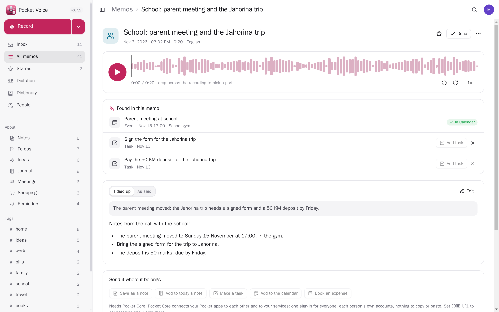
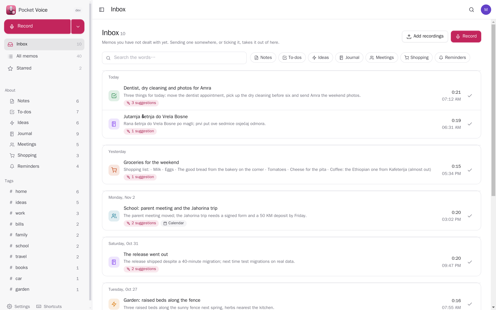
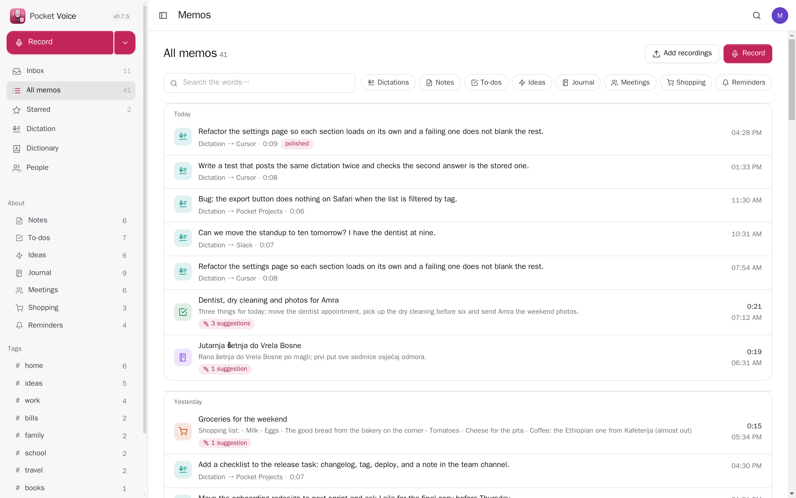
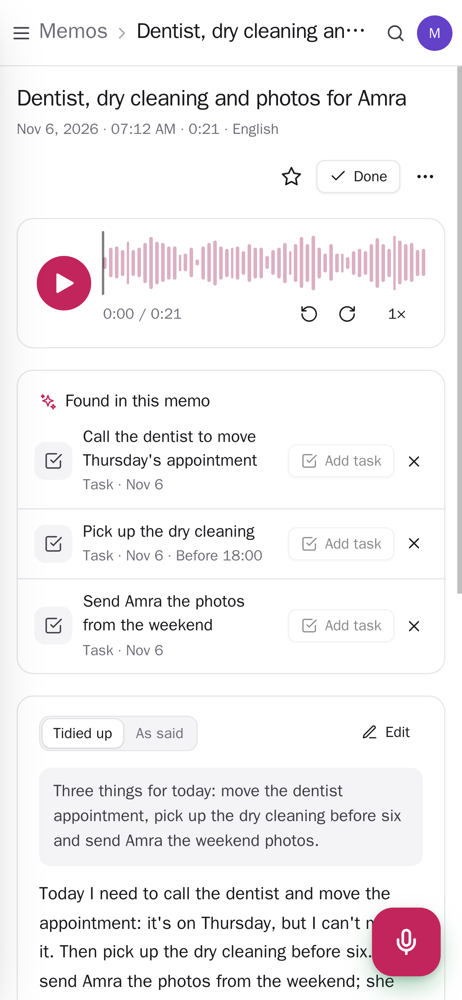
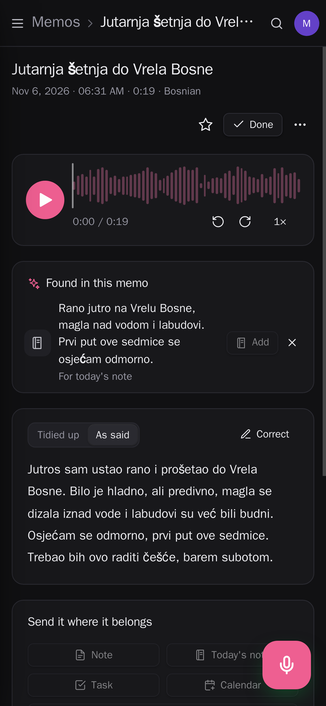

<p align="center"></p>
<h1 align="center">Pocket Voice</h1>
<p align="center">Voice memos on your own server: record on your phone, and the words are written out right there by whisper.cpp — no audio leaves the box. Pocket AI tidies them up, gives each a title and a summary, and finds the tasks, appointments, journal lines and money in what you said; one tap sends them to your notes, today's note, your tasks, your calendar or Pocket Money. Bring in the memos you already have (Apple Voice Memos, WhatsApp voice notes, any audio file), and let other apps write out their dictation here too.<br>One Go binary, one SQLite file, one volume. Part of the Pocket apps; works on its own too.</p>
<p align="center">
  <a href="https://github.com/abjelosevic88/pocket-homelab-voice/actions"></a>
  <a href="https://github.com/abjelosevic88/pocket-homelab-voice/pkgs/container/pocket-homelab-voice"></a>
  <a href="LICENSE"></a>
</p>

---

<p align="center"></p>

<table>
  <tr>
    <td width="50%"></td>
    <td width="50%"></td>
  </tr>
  <tr>
    <td align="center"><sub>The inbox: what you recorded and have not dealt with, with how many suggestions each memo has and where it already went.</sub></td>
    <td align="center"><sub>Every memo by day, with search that ignores accents and alphabets; by kind and by tag in the sidebar.</sub></td>
  </tr>
  <tr>
    <td width="50%"></td>
    <td width="50%"></td>
  </tr>
  <tr>
    <td align="center"><sub>Made for the phone: the microphone button records, the tasks it heard are one tap away.</sub></td>
    <td align="center"><sub>The words follow along as it plays; tap a sentence to hear it. Light and dark follow the system.</sub></td>
  </tr>
</table>

## What it does

- **Record** in the browser on your phone or computer: a calm level line, pause and resume, the screen stays on. Stop, and it is saved and written out. A recording that cannot be sent is never thrown away: try again, or save the file.
- **Written out on your server** by whisper.cpp (in the Docker image for Intel/AMD and ARM64): NVIDIA's Parakeet (about ten times faster, 25 European languages) or OpenAI's Whisper from Fast to Best (about 99 languages), one model for memos and one for dictation from other apps, downloaded when first chosen. Your language or automatic, names and words to expect, and Serbian in Latin letters. Or, per person, OpenAI's transcription API or any OpenAI-compatible speech server.
- **Listen and read along**: a waveform you can tap anywhere, ten seconds back and forward, 1–2× speed, and the words highlighted as they are spoken; tap a sentence to hear it. Correct the words by hand.
- **Tidied up by AI** (Pocket AI through Core, or your own OpenAI key; only the words go, never the recording): punctuation and paragraphs without the "um"s, a title, a short summary, what the memo is about (note, to-do, idea, journal, meeting, shopping, reminder) and a few tags.
- **What it found, one tap away**: tasks with the day you said ("call the dentist tomorrow"), appointments with the time and place, a line for today's journal, money you spent. Nothing goes anywhere until you press its button; skip what you don't want.
- **Send it where it belongs**: a note in Pocket Notes (in your folder, the summary on top and a link back to the recording), a line in today's note, tasks in Pocket Tasks, an event in Pocket Calendar, an expense in Pocket Money. Each memo shows what went where.
- **An inbox**: what you have not dealt with yet. Sending a memo somewhere (or ticking it) takes it out. All memos by day, starred, by kind and by tag, and search that ignores accents and alphabets ("cevapi" finds "Ćevapi" and "ЋЕВАПИ").
- **Bring them in**: Apple Voice Memos, your phone's recorder, WhatsApp voice notes, any m4a, mp3, wav, ogg, opus, webm or flac — each with the day it was recorded. Or type a memo.
- **Keep recordings** forever or let them go after a month to a year (the words stay; starred memos keep theirs).
- **Pushes** through Apprise, ntfy or a webhook: a long memo written out, one that could not be, and a morning list of memos to file.
- **Everyone their own**: each person has their own memos, recordings, settings and connections; admins see no one else's.
- **Export** as JSON (and back in, idempotent) or every recording with its words as a ZIP; a whole-database backup for admins.

## Run it

```sh
docker run -d --name pocket-voice -p 8080:8080 -v ./data:/data \
  -e BASE_URL=https://voice.example.com -e SECURE_COOKIES=true \
  ghcr.io/abjelosevic88/pocket-homelab-voice:latest
```

or `docker compose up -d` with [docker-compose.yml](docker-compose.yml). Browsers only allow the microphone over HTTPS, so put it behind your reverse proxy. Open it, create the first account and record. The first memo downloads the speech model (about 550 MB for Best) into `/data/models`; on a small server Best takes about as long as the recording, Fast a tenth of that. All options: [docs/configuration.md](docs/configuration.md). API: [docs/api.md](docs/api.md).

From an iPhone, a Shortcut with "Record Audio" → "Get Contents of URL" (POST `/api/v1/memos`, form field `file`, your token) sends a memo from the lock screen or the Action button.

## With Pocket Core

Set `CORE_URL` and `CORE_REGISTRATION_KEY` and Voice joins the box: people sign in with Pocket Core, Pocket AI tidies memos up, and through app links each person's memos reach their own Pocket apps with nothing to paste:

| App | What Voice does there | Scopes |
|---|---|---|
| Pocket Notes | a memo as a note in the folder you choose; a line in today's daily note | `notes:write`, `notes:read` |
| Pocket Tasks | the tasks found in a memo, with their day, on the list you choose | `tasks:write`, `tasks:read` |
| Pocket Calendar | an appointment you mentioned, with where | `calendar:write`, `calendar:read` |
| Pocket Money | money you said you spent, as an expense when you press Book | `transactions:write`, `accounts:read` |
| Pocket AI | tidying up and finding what is in a memo; the Ask button on every page | inference |

Other apps can read your memos (`voice:read`: Pocket Day writes the day's memos into your journal, Pocket AI finds "what did I say about the garden?"), add one for you (`voice:write`), or have their own dictation written out here (`voice:transcribe`: words back, nothing kept, optionally tidied by your AI — Pocket Day, Pocket AI and Pocket Launcher's Wispr-style dictation on the Mac use it, so dictation never goes to a cloud service). Events on the bus: `voice.memo_recorded`, `voice.memo_transcribed` (with the words), `voice.memo_filed`. Without Core every connection can be made directly with a URL and a token; the Core-only choices stay visible, greyed out.

## Develop

```sh
make dev     # API on :8080 with demo data + Vite on :5173
make test    # go vet, go test, tsc
make         # web + binary
```

To write out locally outside Docker, install whisper.cpp (`whisper-cli`) and ffmpeg. MIT licensed. Speech recognition by [whisper.cpp](https://github.com/ggml-org/whisper.cpp) (MIT) with OpenAI's Whisper models (MIT).
